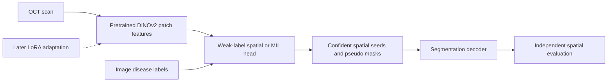

# Meeting notes — updated 15 November 2026

New working tools: `oct.py inspect` generates a patch attention/similarity dashboard and input-normalization comparison. `oct.py finetune --mode lora` and `--mode full` share the self-supervised teacher/student objective. Four one-step local OCT conditions passed on Windows MLX CPU; this does not establish efficacy. See [research workflow](RESEARCH_WORKFLOW.md) and [current validation](RESEARCH_VALIDATION.md).

## One-minute status

The default implementation is now **frozen pretrained DINOv2 → cached dense features**. It is a baseline for later adaptation comparisons, not a lesion segmenter. Real checkpoint inference, 12 local OCT scans, array export and cache reuse are tested locally on Windows CPU. Real-model CI also passed on macOS, Windows and Linux CPU; see [VALIDATION.md](VALIDATION.md). The earlier Mac traceback is unavailable, so we cannot claim to have identified its exact cause.

The Mac setup now uses:
```bash
bash oct.sh setup
bash oct.sh test
bash oct.sh run "/path/to/OCT2017"
bash oct.sh show
```

Only setup installs packages. Test uses two artificial inputs and real weights. Run starts with 12 scans. Add --full for the entire dataset after these checks pass.

## Research question

Can image-level disease supervision and pretrained visual features produce useful spatial lesion predictions without pixel-level training masks?

“Precise” segmentation is an evaluation claim. We need a defined lesion ontology and independent spatial evidence to test it.

## Proposed method-development sequence



Only A → B and feature caching/export are the current baseline implementation. Later boxes are proposed experiments, not claimed results.

## Decisions to make today

1. Define the pixel classes: what exactly counts as the diseased area?
2. Confirm original diagnosis labels and available patient/eye/volume identifiers.
3. Agree on a small annotated validation/test set or compatible external benchmark. Keep its masks out of weakly supervised training.
4. Freeze the baseline protocol: split, crop/resolution, backbone checkpoint, head/decoder and metrics.
5. Compare frozen DINOv2 against LoRA under the same objective. Do not assume improvement.
6. Treat Swin as an optional pretrained backbone comparison unless a custom implementation has a specific purpose.
7. Choose the first resource budget, repeated seeds and rank ablations.
8. Decide release artifacts, licensing and eventual citation metadata.

## Explain these distinctions confidently

- Rank counts independent linear directions, not the number of classes.
- SVD decomposes a matrix; truncation gives a controlled low-rank approximation.
- LoRA constrains the weight update, not the full weight or number of lesion types.
- PEFT is the family; LoRA is one method within it.
- Swin's shifted local attention and multiscale hierarchy are architectural choices; pretrained implementations exist.
- Self-supervised adaptation uses no disease labels. Weakly supervised segmentation needs an explicit connection between image labels and spatial predictions.
- Dense features, attention maps and pseudo masks are different outputs.
- A classification objective can be an intermediate supervision signal without classification being the final deliverable.

## Suggested first comparison table

| Setting | Variable changed | Keep fixed |
|---|---|---|
| Frozen DINOv2 | Reference | Data and weak-label spatial objective |
| DINOv2 + LoRA | Backbone adaptation | Same objective/head/evaluation |
| Full fine-tuning | Adaptation capacity and cost | Same protocol |
| Pretrained Swin | Backbone architecture | Matched task/evaluation and declared capacity differences |

Report spatial performance where references exist, false positives on normal scans, compute/memory/storage and failure examples. Classification accuracy does not substitute for Dice/IoU.

Read the [full study guide](STUDY_GUIDE.md) for worked mathematics and intuition.
